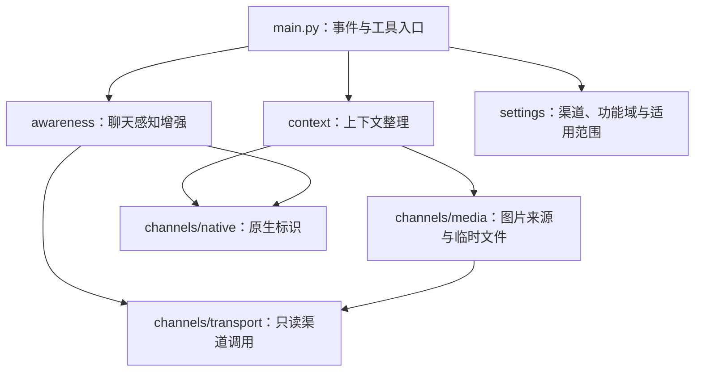

# 模块边界

Context Enishi 的两个功能域通过 `main.py` 组合，依赖共同的渠道读取层和配置解析。功能域彼此不导入、不读取对方的开关。

| 层 | 可以做什么 | 边界 |
| --- | --- | --- |
| `context/` | 请求内容整理、历史像素移除、文字转述缓存、临时图片生命周期、兼容已有 runner 与工具 | 不承担成员统计或群聊事实查询 |
| `awareness/` | 获取人员、环境、消息、头像、角色和已观察到的发言活动；生成可选摘要文本 | 不改模型消息历史、不调用 LLM、不下载或保存图片 |
| `channels/` | 读取来源渠道、解析原生标识；图片层为明确消费者提供临时文件 | 不决定模型上下文策略或人员排序 |
| `settings.py` | 按渠道及机器人／群／话题选择两个独立功能域的配置 | 图片模式不控制聊天感知开关 |
| `main.py` | 注册 AstrBot 事件与稳定工具名，组合两个功能域 | 不直接实现渠道分页或图片改写 |

## 上下文整理

`ContextOrganizer` 管理 `MediaPolicy`、runner 集成、Flow 图片标记兼容和文字缓存。`additions.py` 统一把显式启用的环境提示组合成临时文本内容。已有监控占用的 `step`、`_iter_llm_responses` 和 `execute` 保持函数身份不变。

`channels/message_schema.py` 与 `channels/relations.py` 提供两个功能域共享的消息投影。显式开启当前消息 metadata 时，`ContextOrganizer` 通过 `additions.py` 写入持久身份块；这一步独立于图片策略，且不进行成员或历史查询。环境摘要继续作为临时内容。字段映射见 [消息字段对齐](message-alignment.md)。

## 聊天感知增强

`ChatAwareness` 提供查询与环境视图。`ChatSources` 保留原有历史发言、消息、头像和成员查询实现。`ParticipantDirectory` 负责人员合并、原生名单、只读扫描、去重、时段选择和排序。

QQ 默认最近排序使用 NapCat 成员快照；频次排序读取协议可访问历史。TG 使用 `event.unified_msg_origin` 查询框架现有记录，包含话题范围；无法枚举完整成员名单。统计始终区分原生成员覆盖与观察到的活动，不把扫描上限内的次数称为全量次数。

查询工具默认不自动填充主模型请求。可选摘要只由感知层生成文字，再由上下文层标记为临时内容，遵守原人格提示词与历史保存边界。工具调用本身仍按 AstrBot 原有行为记录工具结果。

## 后续扩展

新增消息压缩、历史保留或内容整理策略放入 `context/`；新增人员关系、会话状态或聊天环境资料放入 `awareness/`；新的 QQ/TG 来源能力先放入 `channels/`。保持工具名稳定、按渠道隔离配置，并为数据范围与截断行为提供可验证的说明。
