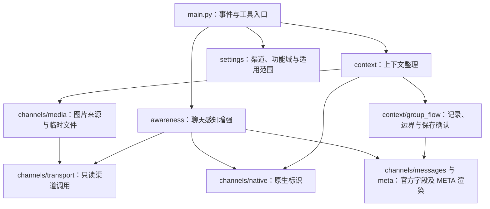

# 模块边界

Context Enishi 的两个功能域通过 `main.py` 组合，依赖共同的渠道读取层和配置解析。功能域彼此不导入、不读取对方的开关。

| 层 | 可以做什么 | 边界 |
| --- | --- | --- |
| `context/` | 请求内容整理、增量流水、保存确认、图片隔离、转述缓存与临时图片生命周期 | 不承担成员统计或群聊事实查询 |
| `awareness/` | 获取人员、环境、消息、头像、角色和已观察到的发言活动；生成可选摘要文本 | 不改模型消息历史、不调用 LLM、不下载或保存图片 |
| `channels/` | 读取来源渠道、解析原生标识；图片层为明确消费者提供临时文件 | 不决定模型上下文策略或人员排序 |
| `settings.py` | 按渠道及机器人／群／话题选择两个独立功能域的配置 | 图片模式不控制聊天感知开关 |
| `main.py` | 注册 AstrBot 事件与稳定工具名，组合两个功能域 | 不直接实现渠道分页或图片改写 |

## 上下文整理

`ContextOrganizer` 管理 `MediaPolicy`、runner 集成、原生群聊流水和文字缓存。`additions.py` 统一组合临时内容。已有监控占用的 `step`、`_iter_llm_responses` 和 `execute` 保持函数身份不变。外部 Flow 的记录与格式包装已移除。

`channels/messages.py` 从原生事件与 QQ/TG 载荷读取官方消息字段，`message_components.py` 提取显式引用和提及，`meta.py` 渲染并转义 META 表格。`awareness/render.py` 将查询的公共范围、覆盖和统计信息放到一个头部，避免逐条复制。

`context/group_flow/store.py` 是 Enishi 自己的单进程文件流水，所有日志及共享游标状态操作由同一个锁保护。`service.py` 选取 `cursor < seq < trigger_seq` 的记录，按原生消息 ID 而不是正文去重。`history.py` 在框架会话保存成功后检查当前消息与后续 assistant 记录，再提交游标；仅收到 LLM 响应不提交。边界代次、单调水位和任务归属防止旧任务覆盖 reset/new。不读写旧 Flow 的数据，也不提供导入导出桥接。详见 [原生群聊流水](group-flow.md)。

`context/captions.py` 管理本插件图片转述的历史投影。每个 runner 首次处理请求时清理可识别旧转述，后续步骤保留本轮完整描述，完成或错误结束时移除完整描述，不写入已转述占位。自动工具图片转述使用临时内容标记；`describe_channel_image` 通过工具调用 ID 关联结果，只移除历史 description，保留调用配对与原始图片 URI。此文字生命周期在图片模式关闭时仍生效，像素处理继续遵循图片开关。转述缓存与历史投影相互独立。

## 聊天感知增强

`ChatAwareness` 提供查询与环境视图。`ChatSources` 保留原有历史发言、消息、头像和成员查询实现。`ParticipantDirectory` 负责人员合并、原生名单、只读扫描、去重、时段选择和排序。

QQ 默认最近排序使用 NapCat 成员快照；频次排序读取协议可访问历史。TG 使用 `event.unified_msg_origin` 查询框架现有记录，包含话题范围；无法枚举完整成员名单。统计始终区分原生成员覆盖与观察到的活动，不把扫描上限内的次数称为全量次数。

查询工具默认不自动填充主模型请求。可选摘要只由感知层生成文字，再由上下文层标记为临时内容，遵守原人格提示词与历史保存边界。工具调用本身仍按 AstrBot 原有行为记录工具结果。

## 后续扩展

新增消息压缩、历史保留或内容整理策略放入 `context/`；新增人员关系、会话状态或聊天环境资料放入 `awareness/`；新的 QQ/TG 来源能力先放入 `channels/`。保持工具名稳定、按渠道隔离配置，并为数据范围与截断行为提供可验证的说明。
